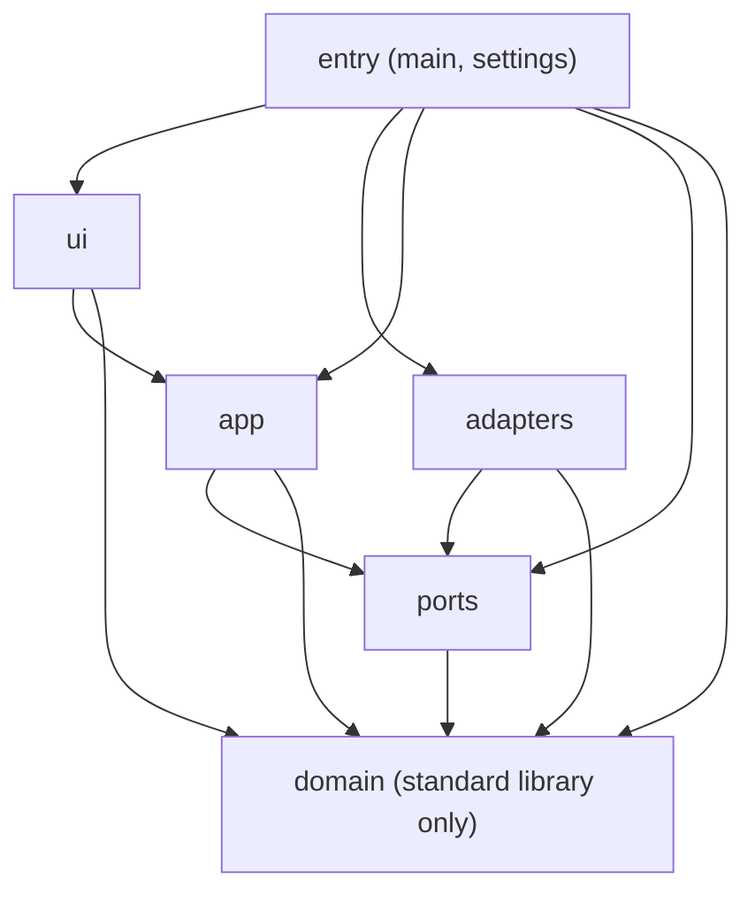
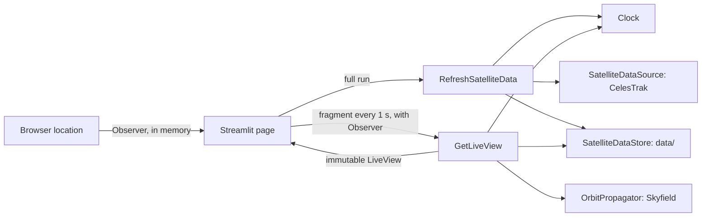

# ARCHITECTURE — Orbita

> Governing file. Together with `security-rules.md` it is the project's source of truth.
> No change may contradict it. If it changes, the impact on the other file is reviewed.
> Status: Approved 2026-10-30.
> Source requirements: `docs/00-requirements.md` (approved 2026-10-30, derived from `DESIGN.md`).

## 1. Overview

Orbita is a web map that shows in real time the position of 20 satellites, the ISS ground track, the user's
location, the approximate distance from the user to each satellite and a card per satellite. The inputs are the
orbital elements (downloaded at most once every 2 h) and the satellite catalog (at most once every 24 h) published
by CelesTrak and saved to local files, plus the user's location read from the browser; the output is a Streamlit
page that refreshes the map every 1 s. Positions are computed locally with SGP4 (Skyfield); the network is only used
to download CelesTrak data. The user's location only lives in memory.

It is an academic project: positions are approximate and must not be used for space operations.

## 2. Layers and dependency rule (hexagonal architecture)

| Layer | Package | Contains | May import |
|---|---|---|---|
| Domain | `orbita.domain` | Types (`OrbitalElements`, `OrbitalDataset`, `CatalogEntry`, `Catalog`, `SatelliteState`, `GroundPoint`, `Observer`, `OrbitType`, `Freshness`), exceptions, satellite list, and the rules of orbit type, freshness, download intervals, time, distance, location validation, catalog data and dataset validation | **Standard library only** |
| Ports | `orbita.ports` | Protocols (`typing.Protocol`) for the external dependencies (§4) | `orbita.domain`, standard library |
| Application | `orbita.app` | Use cases (§3) | `orbita.domain`, `orbita.ports`, standard library |
| Adapters | `orbita.adapters` | Concrete implementations of the ports | `orbita.domain`, `orbita.ports`, standard library, third-party libraries |
| Interface | `orbita.ui` | Streamlit page: map, cards, notices, "My location" button | `orbita.domain`, `orbita.app`, standard library, `streamlit`, map library, browser location component |
| Entry (composition) | `orbita.main`, `orbita.settings` | Reading `.env`, creating and injecting adapters and use cases, starting the page | Everything |

Mandatory rules:
1. `orbita.domain` MUST NOT import anything outside the standard library.
2. `orbita.ports` MUST NOT import `orbita.app`, `orbita.adapters`, `orbita.ui` or the entry layer.
3. `orbita.app` MUST NOT import `orbita.adapters`, `orbita.ui`, the entry layer or third-party libraries; it depends
   only on the ports (DIP).
4. `orbita.adapters` MUST NOT import `orbita.app`, `orbita.ui` or the entry layer.
5. `orbita.ui` MUST NOT import `orbita.adapters`, `orbita.ports` or the entry layer; it receives the use cases from
   `orbita.main`.
6. No module outside the entry layer MUST import `orbita.main` or `orbita.settings`.
7. Use cases receive their dependencies through the constructor (manual injection in `orbita.main`). There MUST NOT
   be DI containers, singletons or mutable global variables. Single exception: `orbita.main` builds the object graph
   once per process with `st.cache_resource`, because Streamlit re-executes the script on every interaction.
8. The rule is verified by `tests/test_architecture.py` (it walks the `import` statements of each module in
   `src/orbita/` with `ast`).



**Why `orbita.ui` is its own layer.** In Epsilon the application drove the window through a `Display` port. In
Orbita it is the other way around: Streamlit runs the page and the page calls the use cases. That makes the page a
driving adapter. It lives in its own layer so it can import `orbita.app` while the driven adapters (CelesTrak,
file, Skyfield) still cannot.

**Why the user's location is not a port.** The location is an input that the user gives to the page, like a click:
`orbita.ui` reads it with the browser location component, turns it into a domain `Observer` and passes it as an
argument to `GetLiveView`. The use cases never ask for it, so no port is needed.

## 3. Main flow



Steps:
1. **Start:** `orbita.main` reads `Settings`, builds adapters and use cases once (`st.cache_resource`) and calls the
   page in `orbita.ui`.
2. **Refresh data:** on each full run of the page, `RefreshSatelliteData` asks the domain whether each download is
   allowed (orbital elements ≥ 2 h and catalog ≥ 24 h since the last download attempt, successful or not,
   `DESIGN.md` §4.2, ADR-003). For each
   allowed download it fetches with `SatelliteDataSource`, validates in the domain and saves with
   `SatelliteDataStore`. If a download or a validation fails, the previous file is kept and the error is logged
   (RF-07). Errors are not retried. A failure of the catalog never blocks the orbital elements.
3. **Location:** when the user presses "My location", `orbita.ui` reads the browser location, validates it with the
   domain (`DESIGN.md` §4.5) and keeps the resulting `Observer` only in the Streamlit session state, in memory.
4. **Live view:** a Streamlit fragment with `run_every=1` calls `GetLiveView(observer)` every second. It loads the
   data (cached in memory until the files change), computes the freshness with the domain and, if positions are
   allowed, asks `OrbitPropagator` for the state of the 20 satellites and the ISS ground track. With an `Observer`, it
   computes each distance with the domain. It returns an immutable `LiveView`.
5. **Draw:** the page draws the map, the user's marker, the cards and the notices from `LiveView`. All text comes
   from `locales/es.json`.

## 4. Ports and adapters

The exact signatures will be in `docs/02-contracts.md`.

| Port (`orbita.ports`) | Responsibility | v1 adapter (`orbita.adapters`) |
|---|---|---|
| `SatelliteDataSource` | Download the raw orbital elements and catalog entries of the 20 satellites | `CelestrakSource` (`httpx`) |
| `SatelliteDataStore` | Load and save the last valid orbital elements and catalog | `JsonFileStore` (`data/orbital_elements.json`, `data/satcat.json`) |
| `OrbitPropagator` | Satellite state (latitude, longitude, altitude, speed) and ground track at given UTC times | `SkyfieldPropagator` |
| `Clock` | Current UTC time | `SystemClock` |

Use cases depend only on these ports. The types that cross a port are domain or standard library types.

## 5. Folder structure

```
orbita/
├── ARCHITECTURE.md  security-rules.md  README.md  DESIGN.md
├── pyproject.toml  uv.lock  .env.example  .pre-commit-config.yaml  .gitignore
├── .vscode/{settings.json, extensions.json}
├── assets/ne_110m_countries.geojson  # offline basemap, Natural Earth (public domain, ADR-002)
├── data/                       # downloaded orbital elements (NOT versioned)
├── locales/es.json             # every user-facing text
├── src/orbita/
│   ├── domain/
│   ├── ports/
│   ├── app/
│   ├── adapters/
│   ├── ui/
│   ├── main.py  settings.py
├── tests/
│   ├── test_architecture.py    # dependency rule
│   ├── domain/  app/  adapters/  ui/
│   └── fixtures/               # synthetic orbital elements generated by code
├── specs/                      # NNN-name.md specs and README.md (index)
└── docs/                       # requirements, contracts, ADRs in docs/adr/, Spanish copies (*.es.md)
```

## 6. Code conventions (mandatory)

**Names**
- Identifiers, docstrings, error messages and logs in English. User-facing text in Spanish, only in
  `locales/es.json`.
- Modules and functions `snake_case`; classes `PascalCase`; constants `UPPER_SNAKE_CASE`.
- Intention-revealing names: no `data`, `tmp`, `obj`, `x2` except for coordinates (`lat`, `lon`).
- Ports end in their role (`OrbitPropagator`); adapters carry the technology as a prefix (`SkyfieldPropagator`,
  `CelestrakSource`).

**Size**
- Functions and methods: **≤ 20 statements**, ≤ 6 arguments, cyclomatic complexity ≤ 8, ≤ 8 branches.
  ruff `PLR0915` max-statements = 20, `PLR0913` max-args = 6, `C901` max-complexity = 8, `PLR0912` max-branches = 8.
- Classes: ≤ 150 lines and a single responsibility. Modules: ≤ 300 lines, no exceptions.

**Types**
- Type annotations mandatory on every signature and attribute; `mypy --strict` with no errors on `src`.
- `from __future__ import annotations` in every module.
- Immutable entities validated on construction (`@dataclass(frozen=True, slots=True)` with validation in
  `__post_init__`).
- Immutable collections in entities (`tuple`, `frozenset`). No `Any` except at the boundary with untyped libraries
  (`skyfield`, `streamlit`, the map library), encapsulated in the adapter or in `orbita.ui` and with an explicit
  suppression that carries its code (`# type: ignore[<code>]`).

**Time**
- The domain and the use cases MUST NOT read the clock: they receive the time from the `Clock` port or as an
  argument.
- Every `datetime` is timezone-aware and in UTC. Conversion to Colombia time happens only in the domain rule of
  `DESIGN.md` §4.3, right before showing it.

**Docstrings**
- Google style on every public module, class and function. Ports document **Preconditions**, **Postconditions**
  and **Raises**.

**Errors**
- Only project exceptions that inherit from `OrbitaError` (`src/orbita/domain/errors.py`).
- Raising `Exception` is forbidden, and so are `except Exception:` and `except:`, except in two places: the body of
  the live view fragment in `orbita.ui` (a failure must not freeze the map) and the `main` function of
  `orbita.main`. There it is logged with `logger.exception` and the matching notice from `locales/es.json` is shown.
- Adapters catch library-specific exceptions and wrap them in a project exception, keeping the cause
  (`raise ... from e`).
- Exceptions are not used for normal control flow; `None` is not returned to signal an error.

**Logging**
- One logger per module (`logging.getLogger(__name__)`); never `print`.
- `key=value` format. Only events, latencies, states and errors are logged.
- Levels: `DEBUG` fine detail, `INFO` execution milestones (download done, dataset loaded), `WARNING` degradations
  (stale data, download skipped by error), `ERROR` failures of one run.

**User location (personal data)**
- `Observer` MUST NOT be logged, written to disk or sent to any service (`security-rules.md`). Its `__repr__` returns
  `Observer(<hidden>)`, so an accidental log line or a traceback does not reveal the coordinates.
- It is kept only in `st.session_state` and passed as an argument; no adapter receives it.

**Concurrency**
- Streamlit runs each browser session in its own thread, and the objects built with `st.cache_resource` are shared
  between them. Every adapter or use case with mutable state MUST protect it with `threading.Lock`.
- `JsonFileStore` writes to a temporary file and renames it (`Path.replace`), so a reader never sees a half-written
  file.
- No network call MUST run inside the 1 s fragment (RNF-03).

**Other**
- No mutable global state. No `print`. No `assert` in production code.
- Paths with `pathlib.Path`, relative to the repo root (`Path(__file__).resolve()`).
- Absolute imports.
- Tests: `pytest`, names `test_<unit>_<behavior>`, **synthetic** fixtures generated by code, no network. The
  CelesTrak adapter is tested with simulated responses; the clock with a fake `Clock`.

## 7. Special modules

### 7.1 Interface (`orbita.ui`)
- Two parts: the full page (runs once per interaction, calls `RefreshSatelliteData` and handles the "My location"
  button) and the live fragment (`st.fragment(run_every=1)`, calls only `GetLiveView`).
- `orbita.ui` draws; it does not decide. Every rule (freshness, orbit type, time conversion, distance, location
  validation) lives in the domain and arrives already applied in `LiveView`.
- The browser location component is used only in `orbita.ui`. If it fails or the user denies the permission, the
  page keeps working without an `Observer` (RF-12).

### 7.2 Texts
- Every text shown to the user MUST come from `locales/es.json`. There MUST NOT be user texts written in the Python
  code.
- Adding a language = adding `locales/<language>.json` with the same keys (out of scope for v1).

## 8. Configuration

- Single file: `.env` at the root (never versioned), read by a small function of our own in `orbita.settings`. No `python-dotenv` (SEC-39; spec 009).
  `.env.example` lists the variables with their default values.
- `orbita.settings` validates the values at startup and produces an immutable `Settings` that `orbita.main`
  injects. Invalid value → `ConfigError` with the variable name.

| Variable | Default | Use |
|---|---|---|
| `ORBITA_DATA_DIR` | `data` | Folder of the saved orbital elements, relative to the repo root |
| `ORBITA_REFRESH_S` | `1` | Map refresh interval in seconds, integer between 1 and 10 |
| `ORBITA_LOG_LEVEL` | `INFO` | `DEBUG`, `INFO`, `WARNING` or `ERROR` |

The 20 satellites, the 2 h and 24 h download intervals and the 3 and 14 day thresholds are domain constants, not
configuration: changing them changes the requirements.

## 9. ADR index

Every new architecture decision is recorded in `docs/adr/ADR-NNN-title.md` BEFORE it is implemented. A replaced ADR
is marked `Superseded by ADR-NNN (date)`.

| ADR | Title | Summary |
|---|---|---|
| [001](docs/adr/ADR-001-hexagonal-architecture-with-streamlit-ui.md) | Hexagonal architecture with a Streamlit interface layer | Six layers; `orbita.ui` is a driving adapter; location enters as an argument, not a port |
| [002](docs/adr/ADR-002-pydeck-map-with-offline-basemap.md) | pydeck map with an offline Natural Earth basemap | `st.pydeck_chart` with `map_provider=None` and local country outlines; no tiles from the internet |
| [003](docs/adr/ADR-003-celestrak-json-by-catalog-number.md) | CelesTrak JSON (OMM) by catalog number | `FORMAT=JSON` per `CATNR`; intervals from the last attempt; no retries |
| [004](docs/adr/ADR-004-browser-location-component.md) | Browser location component | `streamlit-geolocation` for P1 (one-time reading); P3 needs a new ADR |
| [005](docs/adr/ADR-005-https-publication-streamlit-community-cloud.md) | HTTPS publication on Streamlit Community Cloud | Proposed for P3 |
| [006](docs/adr/ADR-006-gitleaks-secret-scanner.md) | gitleaks as the pre-commit secret scanner | Official hook pinned to an exact version |

## 10. Changes

| Date | Section | Change | Reason |
|---|---|---|---|
| 2026-10-30 | 3, 5, 9 | Download intervals from the last attempt and no retries; `assets/` folder for the offline basemap; ADR index filled in. | ADR-002 and ADR-003. |
