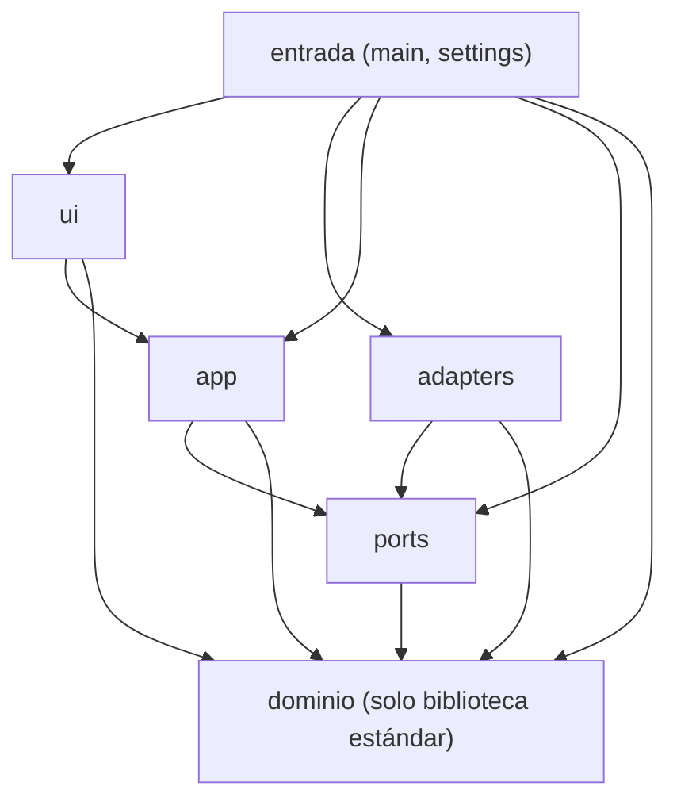
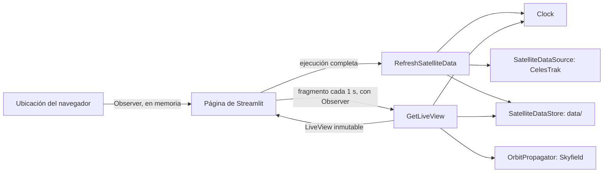

# ARQUITECTURA — Órbita

> Copia de estudio en español. El archivo rector es `ARCHITECTURE.md` (inglés); si difieren, manda el inglés.
> Estado: Aprobado 2026-10-30.
> Requisitos de origen: `docs/00-requirements.md` (aprobados 2026-10-30, derivados de `DESIGN.md`).

## 1. Visión general

Órbita es un mapa web que muestra en tiempo real la posición de 20 satélites, la trayectoria de la ISS, la
ubicación del usuario, la distancia aproximada del usuario a cada satélite y una ficha por satélite. Las entradas
son los elementos orbitales (descargados como máximo una vez cada 2 h) y el catálogo de satélites (como máximo una
vez cada 24 h) que publica CelesTrak, guardados en archivos locales, más la ubicación del usuario leída del
navegador; la salida es una página de Streamlit que refresca el mapa cada 1 s. Las posiciones se calculan
localmente con SGP4 (Skyfield); la red solo se usa para descargar los datos de CelesTrak. La ubicación del usuario
solo vive en memoria.

Es un proyecto académico: las posiciones son aproximadas y no sirven para operaciones espaciales.

## 2. Capas y regla de dependencias (arquitectura hexagonal)

| Capa | Paquete | Contiene | Puede importar |
|---|---|---|---|
| Dominio | `orbita.domain` | Tipos (`OrbitalElements`, `OrbitalDataset`, `CatalogEntry`, `Catalog`, `SatelliteState`, `GroundPoint`, `Observer`, `OrbitType`, `Freshness`), excepciones, lista de satélites y reglas de tipo de órbita, frescura, intervalos de descarga, tiempo, distancia, validación de la ubicación, datos del catálogo y validación de los datos | **Solo biblioteca estándar** |
| Puertos | `orbita.ports` | Protocolos (`typing.Protocol`) de las dependencias externas (§4) | `orbita.domain`, biblioteca estándar |
| Aplicación | `orbita.app` | Casos de uso (§3) | `orbita.domain`, `orbita.ports`, biblioteca estándar |
| Adaptadores | `orbita.adapters` | Implementaciones concretas de los puertos | `orbita.domain`, `orbita.ports`, biblioteca estándar, librerías de terceros |
| Interfaz | `orbita.ui` | Página de Streamlit: mapa, fichas, avisos, botón "Mi ubicación" | `orbita.domain`, `orbita.app`, biblioteca estándar, `streamlit`, librería de mapa, componente de ubicación del navegador |
| Entrada (composición) | `orbita.main`, `orbita.settings` | Leer `.env`, crear e inyectar adaptadores y casos de uso, arrancar la página | Todo |

Reglas obligatorias:
1. `orbita.domain` NO DEBE importar nada fuera de la biblioteca estándar.
2. `orbita.ports` NO DEBE importar `orbita.app`, `orbita.adapters`, `orbita.ui` ni la capa de entrada.
3. `orbita.app` NO DEBE importar `orbita.adapters`, `orbita.ui`, la capa de entrada ni librerías de terceros; solo
   depende de los puertos (DIP).
4. `orbita.adapters` NO DEBE importar `orbita.app`, `orbita.ui` ni la capa de entrada.
5. `orbita.ui` NO DEBE importar `orbita.adapters`, `orbita.ports` ni la capa de entrada; recibe los casos de uso de
   `orbita.main`.
6. Ningún módulo fuera de la capa de entrada DEBE importar `orbita.main` ni `orbita.settings`.
7. Los casos de uso reciben sus dependencias por el constructor (inyección manual en `orbita.main`). NO DEBE haber
   contenedores de inyección, singletons ni variables globales mutables. Única excepción: `orbita.main` construye
   los objetos una vez por proceso con `st.cache_resource`, porque Streamlit vuelve a ejecutar el script en cada
   interacción.
8. La regla la verifica `tests/test_architecture.py` (recorre los `import` de cada módulo de `src/orbita/` con
   `ast`).



**Por qué `orbita.ui` es una capa aparte.** En Epsilon la aplicación manejaba la ventana a través del puerto
`Display`. En Órbita es al revés: Streamlit ejecuta la página y la página llama a los casos de uso. Eso convierte a
la página en un adaptador "conductor". Vive en su propia capa para que pueda importar `orbita.app`, mientras que los
adaptadores "conducidos" (CelesTrak, archivo, Skyfield) siguen sin poder hacerlo.

**Por qué la ubicación del usuario no es un puerto.** La ubicación es una entrada que el usuario le da a la página,
como un clic: `orbita.ui` la lee con el componente de ubicación del navegador, la convierte en un `Observer` del
dominio y se la pasa como argumento a `GetLiveView`. Los casos de uso nunca la piden, así que no hace falta un
puerto.

## 3. Flujo principal



Pasos:
1. **Arranque:** `orbita.main` lee `Settings`, construye adaptadores y casos de uso una sola vez
   (`st.cache_resource`) y llama a la página de `orbita.ui`.
2. **Actualizar datos:** en cada ejecución completa de la página, `RefreshSatelliteData` le pregunta al dominio si
   se permite cada descarga (elementos orbitales ≥ 2 h y catálogo ≥ 24 h desde el último intento de descarga, haya salido
   bien o no, `DESIGN.md` §4.2, ADR-003). Por cada descarga permitida, descarga con `SatelliteDataSource`, valida en el dominio y guarda
   con `SatelliteDataStore`. Si una descarga o una validación falla, se conserva el archivo anterior y el error
   queda en el log (RF-07). Los errores no se reintentan. Un fallo del catálogo nunca bloquea los elementos
   orbitales.
3. **Ubicación:** cuando el usuario presiona "Mi ubicación", `orbita.ui` lee la ubicación del navegador, la valida
   con el dominio (`DESIGN.md` §4.5) y guarda el `Observer` resultante solo en el estado de la sesión de Streamlit,
   en memoria.
4. **Vista en vivo:** un fragmento de Streamlit con `run_every=1` llama a `GetLiveView(observer)` cada segundo.
   Carga los datos (guardados en memoria hasta que los archivos cambien), calcula la frescura con el dominio y, si se
   permiten posiciones, le pide a `OrbitPropagator` el estado de los 20 satélites y la trayectoria de la ISS. Con un
   `Observer`, calcula cada distancia con el dominio. Devuelve un `LiveView` inmutable.
5. **Dibujar:** la página dibuja el mapa, el marcador del usuario, las fichas y los avisos a partir de `LiveView`.
   Todo el texto sale de `locales/es.json`.

## 4. Puertos y adaptadores

Las firmas exactas estarán en `docs/02-contracts.md`.

| Puerto (`orbita.ports`) | Responsabilidad | Adaptador v1 (`orbita.adapters`) |
|---|---|---|
| `SatelliteDataSource` | Descargar los elementos orbitales y las entradas del catálogo de los 20 satélites | `CelestrakSource` (`httpx`) |
| `SatelliteDataStore` | Cargar y guardar los últimos elementos orbitales y catálogo válidos | `JsonFileStore` (`data/orbital_elements.json`, `data/satcat.json`) |
| `OrbitPropagator` | Estado del satélite (latitud, longitud, altura, velocidad) y trayectoria en horas UTC dadas | `SkyfieldPropagator` |
| `Clock` | Hora UTC actual | `SystemClock` |

Los casos de uso solo dependen de estos puertos. Los tipos que cruzan un puerto son del dominio o de la biblioteca
estándar.

## 5. Estructura de carpetas

```
orbita/
├── ARCHITECTURE.md  security-rules.md  README.md  DESIGN.md
├── pyproject.toml  uv.lock  .env.example  .pre-commit-config.yaml  .gitignore
├── .vscode/{settings.json, extensions.json}
├── assets/ne_110m_countries.geojson  # mapa base sin internet, Natural Earth (dominio público, ADR-002)
├── data/                       # elementos orbitales descargados (NO se versiona)
├── locales/es.json             # todos los textos al usuario
├── src/orbita/
│   ├── domain/
│   ├── ports/
│   ├── app/
│   ├── adapters/
│   ├── ui/
│   ├── main.py  settings.py
├── tests/
│   ├── test_architecture.py    # regla de dependencias
│   ├── domain/  app/  adapters/  ui/
│   └── fixtures/               # elementos orbitales sintéticos generados por código
├── specs/                      # specs NNN-nombre.md y README.md (índice)
└── docs/                       # requisitos, contratos, ADR en docs/adr/, copias en español (*.es.md)
```

## 6. Convenciones de código (obligatorias)

**Nombres**
- Identificadores, docstrings, mensajes de error y logs en inglés. Textos al usuario en español, solo en
  `locales/es.json`.
- Módulos y funciones `snake_case`; clases `PascalCase`; constantes `UPPER_SNAKE_CASE`.
- Nombres que revelen intención: nada de `data`, `tmp`, `obj`, `x2`, salvo coordenadas (`lat`, `lon`).
- Los puertos terminan en su rol (`OrbitPropagator`); los adaptadores llevan la tecnología como prefijo
  (`SkyfieldPropagator`, `CelestrakSource`).

**Tamaño**
- Funciones y métodos: **≤ 20 sentencias**, ≤ 6 argumentos, complejidad ciclomática ≤ 8, ≤ 8 ramas.
  ruff `PLR0915` max-statements = 20, `PLR0913` max-args = 6, `C901` max-complexity = 8, `PLR0912` max-branches = 8.
- Clases: ≤ 150 líneas y una sola responsabilidad. Módulos: ≤ 300 líneas, sin excepciones.

**Tipos**
- Anotaciones de tipo obligatorias en toda firma y atributo; `mypy --strict` sin errores en `src`.
- `from __future__ import annotations` en todo módulo.
- Entidades inmutables validadas al construirse (`@dataclass(frozen=True, slots=True)` con validación en
  `__post_init__`).
- Colecciones inmutables en las entidades (`tuple`, `frozenset`). Sin `Any`, salvo en el borde con librerías sin
  tipos (`skyfield`, `streamlit`, la librería de mapa), encapsulado en el adaptador o en `orbita.ui` y con una
  supresión explícita que lleve su código (`# type: ignore[<código>]`).

**Tiempo**
- El dominio y los casos de uso NO DEBEN leer el reloj: reciben la hora del puerto `Clock` o como argumento.
- Todo `datetime` tiene zona horaria y está en UTC. La conversión a hora de Colombia solo ocurre en la regla del
  dominio de `DESIGN.md` §4.3, justo antes de mostrarla.

**Docstrings**
- Estilo Google en todo módulo, clase y función pública. Los puertos documentan **Preconditions**,
  **Postconditions** y **Raises**.

**Errores**
- Solo excepciones del proyecto que heredan de `OrbitaError` (`src/orbita/domain/errors.py`).
- Prohibido lanzar `Exception`, y también `except Exception:` y `except:`, salvo en dos lugares: el cuerpo del
  fragmento de la vista en vivo en `orbita.ui` (un fallo no debe congelar el mapa) y la función `main` de
  `orbita.main`. Ahí se registra con `logger.exception` y se muestra el aviso correspondiente de `locales/es.json`.
- Los adaptadores capturan las excepciones propias de cada librería y las envuelven en una excepción del proyecto,
  conservando la causa (`raise ... from e`).
- Las excepciones no se usan para el flujo normal; no se devuelve `None` para indicar un error.

**Logging**
- Un logger por módulo (`logging.getLogger(__name__)`); nunca `print`.
- Formato `clave=valor`. Solo se registran eventos, latencias, estados y errores.
- Niveles: `DEBUG` detalle fino, `INFO` hitos de ejecución (descarga hecha, datos cargados), `WARNING`
  degradaciones (datos desactualizados, descarga omitida por error), `ERROR` fallos de una ejecución.

**Ubicación del usuario (dato personal)**
- `Observer` NO DEBE registrarse en el log, escribirse en disco ni enviarse a ningún servicio (`security-rules.md`).
  Su `__repr__` devuelve `Observer(<hidden>)`, así una línea de log accidental o un traceback no revelan las
  coordenadas.
- Solo se guarda en `st.session_state` y se pasa como argumento; ningún adaptador la recibe.

**Concurrencia**
- Streamlit ejecuta cada sesión del navegador en su propio hilo, y los objetos creados con `st.cache_resource` se
  comparten entre ellas. Todo adaptador o caso de uso con estado mutable DEBE protegerlo con `threading.Lock`.
- `JsonFileStore` escribe en un archivo temporal y lo renombra (`Path.replace`), así nadie lee un archivo a medio
  escribir.
- Ninguna llamada de red DEBE ejecutarse dentro del fragmento de 1 s (RNF-03).

**Otros**
- Sin estado global mutable. Sin `print`. Sin `assert` en el código de producción.
- Rutas con `pathlib.Path`, relativas a la raíz del repo (`Path(__file__).resolve()`).
- Imports absolutos.
- Tests: `pytest`, nombres `test_<unidad>_<comportamiento>`, fixtures **sintéticas** generadas por código, sin red.
  El adaptador de CelesTrak se prueba con respuestas simuladas; el reloj, con un `Clock` falso.

## 7. Módulos especiales

### 7.1 Interfaz (`orbita.ui`)
- Dos partes: la página completa (se ejecuta una vez por interacción, llama a `RefreshSatelliteData` y maneja el
  botón "Mi ubicación") y el fragmento en vivo (`st.fragment(run_every=1)`, que solo llama a `GetLiveView`).
- `orbita.ui` dibuja; no decide. Toda regla (frescura, tipo de órbita, conversión de hora, distancia, validación de
  la ubicación) vive en el dominio y llega ya aplicada en `LiveView`.
- El componente de ubicación del navegador solo se usa en `orbita.ui`. Si falla o el usuario niega el permiso, la
  página sigue funcionando sin `Observer` (RF-12).

### 7.2 Textos
- Todo texto que vea el usuario DEBE salir de `locales/es.json`. NO DEBE haber textos al usuario escritos en el
  código Python.
- Agregar un idioma = agregar `locales/<idioma>.json` con las mismas claves (fuera del alcance de la v1).

## 8. Configuración

- Un solo archivo: `.env` en la raíz (nunca se versiona), leído con una función propia en `orbita.settings`. Sin `python-dotenv` (SEC-39; spec 009).
  `.env.example` lista las variables con sus valores por defecto.
- `orbita.settings` valida los valores al arrancar y produce un `Settings` inmutable que `orbita.main` inyecta.
  Valor inválido → `ConfigError` con el nombre de la variable.

| Variable | Por defecto | Uso |
|---|---|---|
| `ORBITA_DATA_DIR` | `data` | Carpeta de los elementos orbitales guardados, relativa a la raíz del repo |
| `ORBITA_REFRESH_S` | `1` | Intervalo de refresco del mapa en segundos, entero entre 1 y 10 |
| `ORBITA_LOG_LEVEL` | `INFO` | `DEBUG`, `INFO`, `WARNING` o `ERROR` |

Los 20 satélites, los intervalos de descarga de 2 h y 24 h y los umbrales de 3 y 14 días son constantes del
dominio, no configuración: cambiarlos cambia los requisitos.

## 9. Índice de ADR

Toda decisión nueva de arquitectura se registra en `docs/adr/ADR-NNN-titulo.md` ANTES de implementarla. Un ADR
reemplazado se marca `Superseded by ADR-NNN (fecha)`.

| ADR | Título | Resumen |
|---|---|---|
| [001](adr/ADR-001-hexagonal-architecture-with-streamlit-ui.md) | Arquitectura hexagonal con una capa de interfaz Streamlit | Seis capas; `orbita.ui` es un adaptador conductor; la ubicación entra como argumento, no como puerto |
| [002](adr/ADR-002-pydeck-map-with-offline-basemap.md) | Mapa pydeck con mapa base de Natural Earth sin internet | `st.pydeck_chart` con `map_provider=None` y contornos de países locales; sin teselas desde internet |
| [003](adr/ADR-003-celestrak-json-by-catalog-number.md) | JSON (OMM) de CelesTrak por número de catálogo | `FORMAT=JSON` por `CATNR`; intervalos desde el último intento; sin reintentos |
| [004](adr/ADR-004-browser-location-component.md) | Componente de ubicación del navegador | `streamlit-geolocation` para la P1 (lectura única); la P3 necesita un ADR nuevo |
| [005](adr/ADR-005-https-publication-streamlit-community-cloud.md) | Publicación con HTTPS en Streamlit Community Cloud | Propuesto para la P3 |
| [006](adr/ADR-006-gitleaks-secret-scanner.md) | gitleaks como detector de secretos en pre-commit | Hook oficial fijado a una versión exacta |

## 10. Cambios

| Fecha | Sección | Cambio | Motivo |
|---|---|---|---|
| 2026-10-30 | 3, 5, 9 | Intervalos de descarga desde el último intento y sin reintentos; carpeta `assets/` para el mapa base sin internet; índice de ADR completado. | ADR-002 y ADR-003. |
